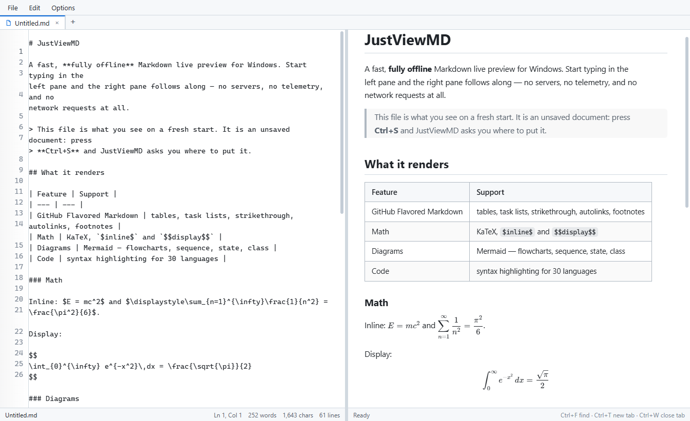
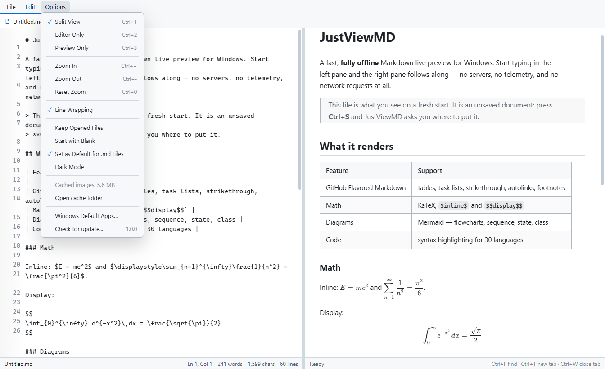

# JustViewMD

**A Markdown editor and live preview for Windows in one 5 MB executable.**

Download `JustViewMD.exe`, double-click it, drop a `.md` file on the window, and
you are editing and previewing at once. GitHub Flavored Markdown, KaTeX math,
Mermaid diagrams and Prism syntax highlighting are all there, and the front end
that renders them - along with every library it uses - is compiled into the
executable, so there is nothing to unpack beside it and nothing to fetch from a
CDN.

It is native Win32 C++17 around the Microsoft Edge WebView2 runtime that already
ships with Windows, and it is deliberately small: one file, no installer, no
service, no account, no telemetry. The only two requests it ever makes are the
pictures a document points at and, unless it is switched off, the update check -
both made by the host, never by the page (see
[The offline guarantee](#the-offline-guarantee)).

```
+--------------------------------------------------------------------------+
| File  Edit  Options      one.md x | notes.md x | Untitled.md x | +        |
+-------------------------+------------------------------------------------+
| Markdown source         |  Rendered document                             |
| (textarea + gutter)   ~ |  GFM, math, diagrams, code                     |
+-------------------------+------------------------------------------------+
| one.md      Ln 12, Col 4   120 words   1.2 kB    split view              |
+--------------------------------------------------------------------------+
```

| At a glance | |
| --- | --- |
| **What it is** | A Markdown editor with a live preview, for Windows |
| **Download** | One file, `JustViewMD.exe`, about 5 MB (x64) - no installer, nothing to unpack |
| **Runs on** | Windows 10 1809 or newer, Windows 11; ARM64 builds from source |
| **Needs** | The Microsoft Edge **WebView2 Runtime**, which ships with Windows |
| **Markdown** | GitHub Flavored Markdown: tables, task lists, footnotes, strikethrough, autolinks |
| **Rendering** | KaTeX math, Mermaid diagrams, Prism syntax highlighting (30+ languages) |
| **Documents** | `.md`, `.markdown`, `.mdx`, `.txt`, `.text`; drag and drop; Explorer context menu |
| **Windows manners** | Tabs, `Ctrl+S`, find and replace, line-number gutter, light and dark themes, settings under `%LOCALAPPDATA%`, no admin rights |
| **Privacy** | No telemetry, no accounts, no analytics, nothing phoning home |
| **Network** | The pictures a document points at, and the update check (switchable off) - nothing else |
| **Licence** | MIT |

## Download

Take `JustViewMD.exe` from the
[latest release](https://github.com/finnuen/JustViewMD/releases/latest). There is
no installer and nothing to unpack: the executable contains the whole
application, including its front end. Put it wherever you like and run it.

* One file, about 5 MB, x64. The Microsoft Edge **WebView2 Runtime** has to be
  present (it ships with Windows 11 and current Windows 10 installs; see
  [Requirements](#requirements)).
* Nothing is installed into `Program Files` and nothing is written to the
  registry by the release itself: settings, the session and the picture cache
  live under `%LOCALAPPDATA%\JustViewMD`.
* *Options → Check for update...* shows the version in use and asks GitHub
  whether a newer release exists. That check also runs quietly in the
  background when the window opens.

## Screenshots

| Split view | Options menu |
| --- | --- |
|  |  |

## Why JustViewMD

* **One file, and it stays one file.** No installer, no runtime to bundle, no
  writes into `Program Files`, no administrator rights. The executable carries
  its own front end and unpacks it under `%LOCALAPPDATA%` on first run; delete
  the file and the application is gone.
* **Offline by construction, not by good intentions.** The page is served from
  an internal `https://app.local` origin behind a `default-src 'none'` Content
  Security Policy, so a document cannot pull anything from the network even if
  it tries. Pictures you link are fetched once by the host, cached locally, and
  served from `https://cache.local` - and a cached copy that disappears while a
  document is open is fetched again, so the preview heals itself.
* **The preview follows your source line, not the scroll bar.** Every rendered
  block remembers the line it came from, so editing near the bottom of a long
  document keeps both panes on the same paragraph instead of merely the same
  percentage of the way down.
* **Editing is the point, not an afterthought.** Tabs with dirty markers, find
  and replace with case, whole-word and regular-expression switches, a gutter
  that follows wrapped lines, zoom with `Ctrl`+wheel, a file dropped anywhere in
  the window, and a `*` in the title bar whenever something is unsaved.
* **It behaves like a Windows program.** Explorer context menu entries for
  `.md` files, a document icon for those files, associations you can switch on
  and off, per-monitor DPI awareness, a title bar that follows the theme, and
  settings in a plain text file you can read and edit by hand.
* **Your files are treated carefully.** Line endings are preserved (a file with
  `CRLF` stays `CRLF`), every buffer is confirmed from the text as it is now
  before anything discards it, the settings file is written atomically, and a
  document that fails to load says why instead of showing nothing.

## Features

**Tabs**

* Several documents in one window, with `+` for a new empty tab and an `x` on
  each tab (or a middle click) to close it. Drag a tab sideways to move it
  along the strip, and that order is the one the session restores.
* New empty tabs are numbered as they appear - `Untitled.md`, `Untitled-2.md`,
  `Untitled-3.md` - and a number is reused once its tab is gone, so no two open
  tabs ever share a name. Saving keeps that name as the suggested file name.
* `Ctrl+Tab` and `Ctrl+Shift+Tab` cycle through the open tabs.
* Closing the last tab opens a fresh empty one instead of quitting the
  application.
* Opening a file that is already open activates its tab instead of loading it
  twice; a single untouched empty tab is reused rather than duplicated.
* Tab context menu: close, close others, copy full path.

**Menus**

* **File** - new tab, open, save, save as, reload from disk, close tab, close
  all tabs.
* **Edit** - undo, redo, cut, copy, paste, select all, find, find and replace.
* **Options** - view mode (split / editor only / preview only), zoom, line
  wrapping, keep opened files, start with a blank document, set as default for
  `.md` files, dark mode, the size of the picture cache with a row that opens
  its folder, Windows default apps, and the update check with the version in
  use beside it. Every switch is remembered
  between runs. The menu stays open while its switches are flipped, so several
  can be changed in one go; clicking somewhere else or pressing `Escape` closes
  it. The menu never removes a cached picture; it only tells you what is there.
* `Alt+F`, `Alt+E`, `Alt+O` open a menu with the keyboard. Once a menu is
  open, sliding along the menu bar switches menus; clicking somewhere else
  closes it.

**Editing**

* Split view with a resizable divider (drag it, or double-click to reset).
* Line-number gutter that follows wrapped lines.
* Status bar with cursor position, word, character and byte counts.
* Realtime preview, debounced while typing.
* Find and replace with match highlighting, `Enter` / `F3` for next,
  `Shift+F3` for previous, `Ctrl+Enter` to replace, case, whole-word and
  regular-expression switches, and replace-all.
* Zoom with `Ctrl` `+` / `-` / `0` or `Ctrl`+wheel.
* Light and dark themes, dark by default.
* Custom context menu (undo, redo, cut, copy, paste, select all, find, wrap,
  file and tab actions) instead of the browser's.

**Rendering**

* GitHub Flavored Markdown - tables, task lists, strikethrough, autolinks,
  footnotes.
* Math with KaTeX: `$inline$`, `$$display$$`, `\(inline\)`, `\[display\]`.
* Diagrams with Mermaid, fenced as ````` ```mermaid `````.
* Syntax highlighting with Prism for 30+ languages.
* Pictures that a document points at on the web: the host downloads each one
  once into `%LOCALAPPDATA%\JustViewMD\cache` and shows it from there, so a
  document with online images also renders offline once it has been opened.
  A picture that cannot be fetched keeps the broken-image placeholder and says
  why on hover. Nothing ever empties that cache but you: the Options menu shows
  how much it holds and opens the folder.
* Scroll synchronisation driven by the document itself: each rendered block
  knows the source line it came from, so both panes follow the same line
  rather than merely the same percentage.

**Files**

* `Ctrl+O` open, `Ctrl+S` save, `Ctrl+Shift+S` save as, `Ctrl+T` new tab.
* Drag and drop a `.md`, `.markdown`, `.mdx`, `.txt` or `.text` file anywhere on
  the window, preview included; a drop never reaches the embedded browser, so
  the page cannot navigate away from the document being edited. Text selections
  can be dropped too and are inserted at the cursor.
* The title bar shows the active file name, with `*` while there are unsaved
  changes; the active tab carries a dot.
* Unsaved changes are confirmed before anything that would discard them,
  including closing the window, closing a tab and reloading from disk.
* **Keep opened files** (Options menu, off by default): the documents open at
  exit come back on the next start, in the same order, with the same tab active.
  A file named on the command line joins them as an extra tab (and becomes the
  active tab), so opening a second document does not throw the first one away;
  naming a file that is already open activates its tab instead of opening it
  twice. Files that have since been deleted are skipped.
* **Start with blank** (Options menu, off by default): the window opens on an
  empty `Untitled.md` instead of the welcome document. The tab is numbered
  like any other new tab, so a second blank tab becomes `Untitled-2.md`. Files
  named on the command line and the "Keep opened files" list still win.

**Updates**

* The version in use is printed beside *Options → Check for update...*. When a
  newer release exists, the row reads `1.0.1 → 1.0.2` and a *Get JustViewMD
  1.0.2...* row appears below it, which opens the release page in your browser.
* The check runs in the background each time the window opens and never
  interrupts: it only ever shows up in the Options menu. Asking from the menu
  reports itself with a toast, because then you asked.
* Nothing is downloaded and nothing replaces the running executable; the check
  reads the public releases API of this repository and nothing else.
  `checkForUpdate=0` in `settings.ini` stops the automatic check, and the row
  in the menu keeps working either way.

## Integration

* **Explorer context menu.** `--register` adds "Open with JustViewMD" to the
  context menu of `.md`, `.markdown` and `.mdx` files below
  `HKEY_CURRENT_USER`. The first run does it automatically; `--no-register`
  and `--unregister` opt out.
* **Default application.** *Options → Set as Default for .md Files* registers
  a `JustViewMD.Document` ProgID for `.md`, `.markdown` and `.mdx`, with the
  document icon for those files and this executable for the open command.
  Unchecking it removes only the entries this application wrote, so a choice
  made elsewhere survives.
* Windows protects the user's own choice: when a `UserChoice` key hands an
  extension to another application, the menu says so instead of pretending the
  checkbox did more than it did, and offers *Windows default apps* for the rest
  of the job. That is also why the checkbox describes "registered", not
  "is currently the handler Windows uses".
* Both icons are in the executable: `IDI_APPICON` (window, taskbar, Alt+Tab)
  and `IDI_DOCICON` (associated documents, and the `DefaultIcon` of the
  ProgID).

## Requirements

* Windows 10 1809 or newer (Windows 11 included), x64 or ARM64.
* The Microsoft Edge **WebView2 Runtime**. It ships with Windows 11 and with
  current Windows 10 installs; if it is missing, install Microsoft's free
  "Evergreen WebView2 Runtime".
* To build: CMake 3.20+, and either Visual Studio 2019/2022 with the C++
  workload or MinGW-w64. Ninja is used when it is on `PATH`.
* Internet access the **first** time the project is configured, to fetch the
  WebView2 SDK from NuGet (about 10 MB). Configure with
  `-DJVMD_WEBVIEW2_ROOT=<unpacked package>/build/native` to skip that.

## Building

```bat
build.bat
```

The script finds a compiler (MSVC first, then MinGW-w64), configures, builds and
copies the result to `dist\`:

```
dist\JustViewMD.exe
```

One file. On the first start of a version the executable unpacks its front end
into `%LOCALAPPDATA%\JustViewMD\assets\<version>\` (about 4 MB, well under a
tenth of a second); MinGW builds also unpack the WebView2 loader into
`%LOCALAPPDATA%\JustViewMD\bin\<version>\`. Later starts reuse both, and a
rebuild replaces the copy, so development never serves yesterday's `app.js`.

To build by hand:

```bat
:: MSVC
cmake -S . -B build -G Ninja -DCMAKE_BUILD_TYPE=Release
cmake --build build
```

```bat
:: MinGW-w64
cmake -S . -B build -G Ninja -DCMAKE_BUILD_TYPE=Release -DCMAKE_CXX_COMPILER=g++
cmake --build build
```

MSVC links `WebView2LoaderStatic.lib` and the C runtime statically, so the result
is one self-contained executable. MinGW-w64 cannot link that library (it is
Visual C++ code and wants that CRT), so the redistributable
`WebView2Loader.dll` is compiled into the executable as a resource, unpacked
under `%LOCALAPPDATA%` on first use, and loaded by absolute path. Either way the
only imports are Windows system DLLs, and nothing has to travel next to the
executable.

Editing `assets/*` needs `cmake --build build` (the front end is part of the
executable, so a rebuild and relink is the point). For a front-end loop without
rebuilding, point the build at the source folder:

```bat
build\bin\JustViewMD.exe --assets assets
```

> The MinGW-w64 configuration is the one this release was built and exercised
> with, warning-free under `-Wall -Wextra`. The MSVC configuration keeps the
> same sources and flags (`/W4`) but has not been rebuilt on a machine with
> Visual Studio installed, so treat that path as untested until it has been.

## Releasing

A release is a tag `vX.Y.Z` with `JustViewMD.exe` as its only asset. That version
lives in exactly one place:

```cmake
project(JustViewMD VERSION 1.0.1 LANGUAGES CXX)
```

CMake writes it out to a generated header that the resource script (the version
in the file's properties) and the host (the Options menu, the update check and
`--help`) both use, so the tag, the file properties and what the application
reports cannot drift apart. Bumping a release is that one edit, a rebuild, and a
publish.

If you are changing this repository rather than just using it, read
[AGENTS.md](AGENTS.md) first.

## Command line

| Option | Effect |
| --- | --- |
| `<file>` | Open that document at startup. |
| `--register` | Add the Explorer context menu entries and exit. |
| `--unregister` | Remove the context menu entries and the file associations, then exit. |
| `--no-register` | Do not add the context menu entries on first run. |
| `--assets <dir>` | Serve the front end from that folder instead of the unpacked embedded copy (development). |
| `--devtools` | Open the WebView2 developer tools window at startup. |
| `--log [file]` | Write a diagnostic log. Without a file name it goes to `%LOCALAPPDATA%\JustViewMD\justviewmd.log` (UTF-16). |
| `--help`, `-h`, `/?` | Show usage. |

Exit codes: `0` success, `2` COM initialisation failed, `3` the front end could
not be unpacked (or the `--assets` folder has no `index.html`), `4` window class
registration failed, `5` the window could not be created, `6` WebView2 could not
be started.

## Keyboard

| Keys | Action |
| --- | --- |
| `Ctrl+T` / `Ctrl+N` | New tab |
| `Ctrl+O` | Open a file in a new tab |
| `Ctrl+S` / `Ctrl+Shift+S` | Save / save as |
| `Ctrl+W` | Close the active tab |
| `Ctrl+Tab` / `Ctrl+Shift+Tab` | Next / previous tab |
| `Ctrl+F` / `Ctrl+H` | Find / find and replace |
| `Enter` / `F3` / `Shift+F3` | Next match / next / previous |
| `Ctrl+Enter` | Replace the current match |
| `Escape` | Close the find bar, menu or context menu |
| `Ctrl+1` / `Ctrl+2` / `Ctrl+3` | Split / editor only / preview only |
| `Ctrl+Z` / `Ctrl+Y` | Undo / redo |
| `Ctrl+X` / `Ctrl+C` / `Ctrl+V` / `Ctrl+A` | Cut / copy / paste / select all |
| `Ctrl` `+` / `Ctrl` `-` / `Ctrl+0` / `Ctrl`+wheel | Zoom in / out / reset |
| `Tab` / `Shift+Tab` | Indent / outdent the selected lines |
| `Alt+F` / `Alt+E` / `Alt+O` | Open the File / Edit / Options menu |

## Settings

The options and the session live in one plain text file:

```
%LOCALAPPDATA%\JustViewMD\settings.ini
```

It is written whenever an option changes and when the window closes, always
through a scratch file and a rename, so a crash can never leave half a file
behind. The format is one `key=value` per line; lines starting with `;` or `#`
are comments. Keys you do not list keep their default, and unknown keys are
ignored. The application rewrites the whole file, so edit it while the
application is closed.

The same folder also holds the WebView2 profile (`WebView2\`), the unpacked
front end (`assets\<version>\`), the pictures downloaded from the web
(`cache\`) and, on MinGW builds, the unpacked loader (`bin\<version>\`).
Deleting one of the unpacked copies is harmless: the next start writes it again
from the executable. The picture cache is never pruned by the application
itself; *Options → Cached images / Open cache folder* shows what it holds and
takes you to it, and clearing it only costs the pictures being fetched again.

| Key | Default | Meaning |
| --- | --- | --- |
| `viewMode` | `split` | `split`, `editor` or `preview`. |
| `darkMode` | `1` | Dark theme. |
| `wrapLines` | `1` | Soft wrap in the source pane. |
| `keepOpenedFiles` | `0` | Restore the open documents on the next start. |
| `startBlank` | `0` | Open an empty tab instead of the welcome document. |
| `checkForUpdate` | `1` | Ask GitHub for a newer release in the background on start-up. |
| `sessionOpen` | - | One line per file to reopen, in tab order. |
| `sessionActive` | - | The file whose tab was active. |

Earlier releases kept these values in `HKCU\Software\JustViewMD`. The first
start of this version reads them, writes the file, and then removes the five
values and the `Session` subkey that it owned. Values left below that key by an
older, unrelated JustViewMD are not touched.

## The offline guarantee

The page is kept off the network; the host does the one job that needs it:

1. `assets/vendor/` contains marked, KaTeX (script, stylesheet, woff2 fonts),
   Prism and Mermaid, all vendored at pinned versions.
2. `assets/index.html` carries a Content-Security-Policy of
   `default-src 'none'` that allows only the page's own origin
   (`https://app.local`), the local picture cache (`https://cache.local`) and
   `file:`. A picture on the web is therefore refused by the page itself, so
   nothing is ever loaded behind the reader's back.
3. The host maps the unpacked front end onto the virtual host `https://app.local/`
   and navigates there, which gives the page a normal secure origin and keeps
   font and module loading reliable. If a runtime is too old for virtual host
   mapping, the host falls back to a `file://` URL.
4. The pictures a document points at are the only thing that ever leaves the
   machine: the host downloads each one once (WinHTTP, following redirects)
   into `%LOCALAPPDATA%\JustViewMD\cache`, serves it to the page as
   `https://cache.local/<name>`, and reuses that copy on every later render -
   with no network at all once the cache holds it. That folder is never pruned
   by the application: *Options* reports its size and opens it in Explorer, and
   a picture removed from it is simply fetched again the next time a document
   needs it.
5. The update check is the second and last request: one `GET` of
   `api.github.com/repos/finnuen/JustViewMD/releases/latest`, the public
   document GitHub serves to anyone. It carries no account, no identifier and
   not even the version in use, and it is made by the host when the window
   opens (and when *Options → Check for update...* asks) - never by the page.
   `checkForUpdate=0` in `settings.ini` turns the automatic one off; the tag and
   the page address of the newest release are all the application takes from the
   answer.

The embedded browser itself is started with `--disable-background-networking`,
`--disable-component-update`, `--disable-sync` and friends, so the engine stays
quiet as well.

## Project layout

```
CMakeLists.txt              build configuration, fetches the WebView2 SDK
                            (the project version here is the one in the file
                            properties, the Options menu and the update check)
build.bat                   one-click build (MSVC or MinGW)
AGENTS.md                   the rules for changing this repository
.gitignore                  build and release output is never committed
docs/                       screenshots used by this file
src/main.cpp                the whole host: window, tabs, files, IPC, settings
src/resource.h              resource identifiers
src/app.rc                  icons and version information
src/app.ico                 application icon, 16-256 px
src/file-icon.ico           document icon for .md files, 16-256 px
src/app-icon.png            source image for the application icon
src/file-icon.png           source image for the .md document icon
assets/index.html           page frame and content security policy
assets/style.css            themes, panes, tabs, menus, find bar, gutter
assets/app.js               tabs, editor, render pipeline, scroll sync, IPC client
assets/welcome.md           the document shown when no file is given
                            (unless "Start with blank" is on)
assets/vendor/              marked, KaTeX, Prism, Mermaid (+ licenses)
tools/fetch-vendor.ps1      refresh the vendored libraries
tools/make-icon.ps1         regenerate the .ico files from their PNG artwork
```

## How it works

**Host.** `src/main.cpp` creates a window, unpacks the front end that is
compiled into the executable (once per version, into
`%LOCALAPPDATA%\JustViewMD\assets\<version>`; MinGW builds unpack the WebView2
loader the same way into `bin\<version>`), starts the WebView2 environment
and controller, maps that folder to `https://app.local/` and the picture cache
to `https://cache.local/`, navigates, and then
acts as a small file server for that page: it owns the tab list (paths, names,
active index), reads and writes documents, runs the common file dialogs, keeps
the window title and the dirty markers, owns the drop target, and reads and
writes the options and the session in `%LOCALAPPDATA%\JustViewMD\settings.ini`.
The drop target is registered on
the main window *and* on the WebView2's own child windows: a drop is delivered
to the window under the cursor and OLE does not climb to its parent, so the main
window alone only ever sees drops on the frame. `AllowExternalDrop` is off, and
the host turns every dropped file into a tab instead of letting the embedded
browser navigate to it.

**Page.** `assets/app.js` owns a `<textarea>` per tab, renders Markdown into
`#markdown`, and talks to the host over `window.chrome.webview.postMessage`.
Rendering is debounced, Mermaid runs asynchronously after the HTML is in place,
and KaTeX render errors fall back to the raw TeX so a typo cannot blank out the
preview. A picture with an `http(s)` address is never loaded by the page: the
render collects the addresses, asks the host for each one with `fetchImage`,
remembers the `https://cache.local/<name>` address it gets back, and swaps it in -
so the same picture is neither downloaded nor even requested twice. A cached
copy that has disappeared under it - the folder is the reader's to empty - is
noticed from the failed load and asked for again, so the preview recovers
without a restart.

**Update check.** The check behind *Options → Check for update...* - and the one
that runs when the window opens - is a single `GET` of
`https://api.github.com/repos/finnuen/JustViewMD/releases/latest` on a worker
thread, through the same WinHTTP path the pictures use. The release's `tag_name`
is compared with the version compiled into the executable; the page is told the
outcome (`update`) and shows it in the Options menu, and as a toast only when
the user asked for that check. Nothing is downloaded and nothing replaces the
running executable: *Get JustViewMD x.y.z...* opens the release page in the
reader's own browser.

**Messages.** Page to host:
| Type | Payload | Meaning |
| --- | --- | --- |
| `ready` | - | The page is up and wants the tab list and the documents. |
| `dirty` | `index`, `value` | That tab changed since its last save. |
| `snapshot` | `index`, `content` | A copy of a buffer, sent when the window loses focus. |
| `save`, `saveAs` | `index`, `content` | Write that tab to its path, or through the file dialog. |
| `open` | - | The user asked for the file dialog. |
| `newTab` | - | Add an empty tab. |
| `tabSelect` | `index` | The user activated a tab. |
| `tabClose` | `index`, `content` | Close one tab, with its live text. |
| `tabReorder` | `from`, `to`, `active` | A tab was dragged to a new place in the strip; the host keeps the same order, and the same session. |
| `closeAll`, `closeOthers` | `keep` | Close every tab, or every tab but one. |
| `reload` | - | Re-read the active document from disk. |
| `content` | `reason`, `index`, `content` | The buffer, answering a `requestContent`. |
| `zoom`, `zoomIn`, `zoomOut`, `zoomReset` | `value` | Zoom level changes. |
| `fetchImage` | `url` | The preview wants a picture from the web; the host downloads and caches it. |
| `setting` | `name`, `value` | An Options menu switch. |
| `setDefaultApp` | - | Register or remove the file associations. |
| `openDefaultApps` | - | Open the Windows "default apps" page. |
| `cacheStats` | - | The Options menu was opened; report what the picture cache holds. |
| `openCacheFolder` | - | Open the picture cache folder in File Explorer. |
| `checkForUpdate` | - | The user asked for an update check; report it with a toast, unlike the one at start-up. |
| `openReleasePage` | - | Open the newest release's page in the default browser. |
| `log` | `text` | A diagnostic line (page errors are reported this way). |

Host to page:

| Type | Payload | Meaning |
| --- | --- | --- |
| `settings` | `view`, `dark`, `keepOpened`, `startBlank`, `wrap`, `defaultApp` | The stored options. |
| `tabs` | `items` (`name`, `path`), `active` | The whole tab list; it is authoritative, so the page drops anything past its end. |
| `document` | `index`, `name`, `path`, `content`, `dirty`, `active` | One document's text. Restoring sends them all, the active one last. |
| `saved` | `index`, `path`, `name` | A tab was written to disk. |
| `closeTab` | `index`, `active` | Drop one tab. |
| `collapse` | `keep` | Keep one tab, drop the rest; sent before the new `tabs`. |
| `requestContent` | `reason`, `index` | Ask for a tab's text, with a timer that answers if the renderer never does. |
| `defaultAppState` | `value`, `notice` | The association state, with an honest notice when Windows disagrees. |
| `insertText` | `text` | Insert a dropped or pasted text at the cursor. |
| `zoom` | `value` | The zoom level to apply. |
| `imageReady` | `url`, `src` | That picture is in the cache; show it from `src`. |
| `imageFailed` | `url`, `message` | That picture could not be fetched, or was not a picture; keep the placeholder. |
| `cacheSize` | `files`, `bytes` | What the picture cache holds, for the Options menu. |
| `update` | `state` (`idle`/`checking`/`uptodate`/`available`/`failed`), `current`, `latest`, `url`, `message`, `asked` | Where the update check stands. `asked` is the difference between the silent background check and one the user started. |

The host never guesses what is in a tab: a close, a close-all, a close-others,
an open, a drop or a new document asks the page for the buffers it needs, so
the confirmations always talk about the text as it is now.

## Maintenance

```powershell
# Refresh the front-end libraries at the versions pinned in the script.
powershell -ExecutionPolicy Bypass -File tools\fetch-vendor.ps1

# Regenerate the application icon from src\app-icon.png.
powershell -ExecutionPolicy Bypass -File tools\make-icon.ps1

# Regenerate the .md document icon from src\file-icon.png. That artwork carries
# a lot of empty canvas, so it is cropped to its content and scaled to fill the
# tile; without that the page sits small next to the other file icons.
powershell -ExecutionPolicy Bypass -File tools\make-icon.ps1 `
    -SourcePath src\file-icon.png -OutputPath src\file-icon.ico `
    -CropToContent -SkipRedraw -ContentFill 0.98
```

`fetch-vendor.ps1` also refreshes `assets/vendor/licenses/`. Committing the
result keeps a checkout buildable without any of those tools.

## Third-party software

JustViewMD itself is Windows-only C++17 and has no dependencies beyond the
Windows SDK and the WebView2 loader. The front end bundles:

| Library | Version | License |
| --- | --- | --- |
| [marked](https://github.com/markedjs/marked) | 18.1.1 | MIT |
| [KaTeX](https://github.com/KaTeX/KaTeX) | 0.19.0 | MIT |
| [Prism](https://github.com/PrismJS/prism) | 1.30.0 | MIT |
| [Mermaid](https://github.com/mermaid-js/mermaid) | 10.9.8 | MIT |

Their license texts are in `assets/vendor/licenses/`.

## Questions people ask

**Do I have to install anything?** No. A release is a single `.exe`; put it
wherever you like and run it. The only thing that has to be present on the
machine is the WebView2 runtime, which is part of Windows 11 and of current
Windows 10 installs.

**Does it need the internet?** Not to open, edit or render a document: the whole
front end, libraries included, is inside the executable. Two things can touch
the network, both made by the host and both easy to reason about - pictures a
document links to (fetched once, then served from the local cache) and the
update check (`checkForUpdate=0` switches the automatic one off).

**Is it portable?** It never needs installing, so it runs from a USB stick or
any folder you like. Its settings, tab session and picture cache live per user
in `%LOCALAPPDATA%\JustViewMD` rather than beside the executable, so a stick
carries the program but not your settings.

**Does it write to the registry?** Only for the Explorer integration you ask
for: the context menu entry, the `.md` associations, the document icon. All of
it is below `HKEY_CURRENT_USER`, needs no administrator rights, and
`--unregister` takes it back out. It also *reads* the old
`HKCU\Software\JustViewMD` values once, to migrate options from releases that
predate `settings.ini`, and then removes what it wrote there.

**How large a document can it open?** Up to 64 MB. Above roughly 1.5 MB of
source, syntax highlighting and diagrams step aside so typing stays instant; the
status bar says "Large document" while that is the case.

**Which Markdown dialect?** GitHub Flavored Markdown - tables, task lists,
footnotes, strikethrough, autolinks - plus the extras a Markdown document
usually comes with: `$...$` and `$$...$$` math, Mermaid fences, and fenced code
highlighting for 30+ languages.

**Does it do WYSIWYG?** No, and it does not pretend to: the left pane is the
file, the right pane is what that file renders to. That is what keeps the file
in front of you the one that gets saved, byte for byte, line endings included.

**How do I know a new version exists?** *Options → Check for update...* shows
the version in use; when a newer release exists the row reads `1.0.1 → 1.0.2`
and a *Get JustViewMD 1.0.2...* row opens the release page in your browser. The
same check runs quietly in the background each time the window opens.

## Notes and limitations

* The title bar follows the theme switch on both Windows 10 and Windows 11.
  Windows 11 additionally takes the exact caption and border colours; Windows 10
  has no per-application caption colour, so its title bar uses the standard DWM
  dark caption rather than the page's own background.
* Syntax highlighting covers the languages Prism bundles here (30+ of the most
  common ones). Adding another is a one-line change in
  `tools/fetch-vendor.ps1` followed by a re-run.
* Mermaid renders when the vocabulary the bundled version understands is used;
  unsupported diagram types show their error message in place of the diagram,
  exactly as they do in a browser.
* The application is per-user: the Explorer integration and the associations
  live below `HKEY_CURRENT_USER` and need no administrator rights. Windows may
  still show a `UserChoice` set for the same extension by another
  application - the Options menu reports that instead of hiding it.
* Pictures from the web are fetched by the host with the system's proxy and TLS
  settings, one request per address, four at a time, 32 MB per picture. Only
  bytes that really are a picture are written to the cache; a login page or an
  error document is refused and the document keeps the broken-image placeholder
  with the reason on hover. Nothing is ever sent back.
* WebView2 requires the runtime to be installed. If the app cannot start the
  engine, it says so instead of failing silently.
* A document larger than 64 MB is refused rather than opened, and above about
  1.5 MB of source the preview turns syntax highlighting and diagrams off so
  that typing stays instant (the status bar says so).
* The application is single-instance per window: launching a second copy opens
  its own window, and the same document can be open in both.
