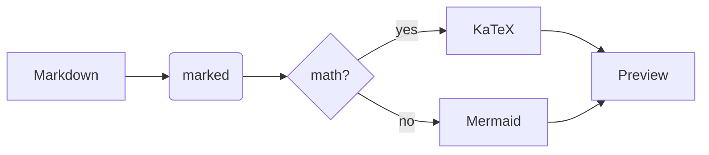

# JustViewMD

A fast, **fully offline** Markdown live preview for Windows. Start typing in the
left pane and the right pane follows along — no servers, no telemetry, and no
network requests at all.

> This file is what you see on a fresh start. It is an unsaved document: press
> **Ctrl+S** and JustViewMD asks you where to put it.

## What it renders

| Feature | Support |
| --- | --- |
| GitHub Flavored Markdown | tables, task lists, strikethrough, autolinks, footnotes |
| Math | KaTeX, `$inline$` and `$$display$$` |
| Diagrams | Mermaid — flowcharts, sequence, state, class |
| Code | syntax highlighting for 30 languages |

### Math

Inline: $E = mc^2$ and $\displaystyle\sum_{n=1}^{\infty}\frac{1}{n^2} = \frac{\pi^2}{6}$.

Display:

$$
\int_{0}^{\infty} e^{-x^2}\,dx = \frac{\sqrt{\pi}}{2}
$$

### Diagrams



### Code

```cpp
// The host parses the command line with CommandLineToArgvW.
int APIENTRY wWinMain(HINSTANCE instance, HINSTANCE, LPWSTR, int show) {
    (void)SetProcessDpiAwarenessContext(DPI_AWARENESS_CONTEXT_PER_MONITOR_AWARE_V2);
    return RunApplication(instance, show);
}
```

### Task lists and footnotes

- [x] Split view with synchronized scrolling
- [x] `Ctrl+O` open, `Ctrl+S` save, `Ctrl+Shift+S` save as
- [x] Drag a `.md` file onto the window
- [x] Drag a tab to move it along the strip
- [ ] Write something of your own[^note]

[^note]: Footnotes work in the offline build too — they are rendered by a small
    extension that ships with the app.
